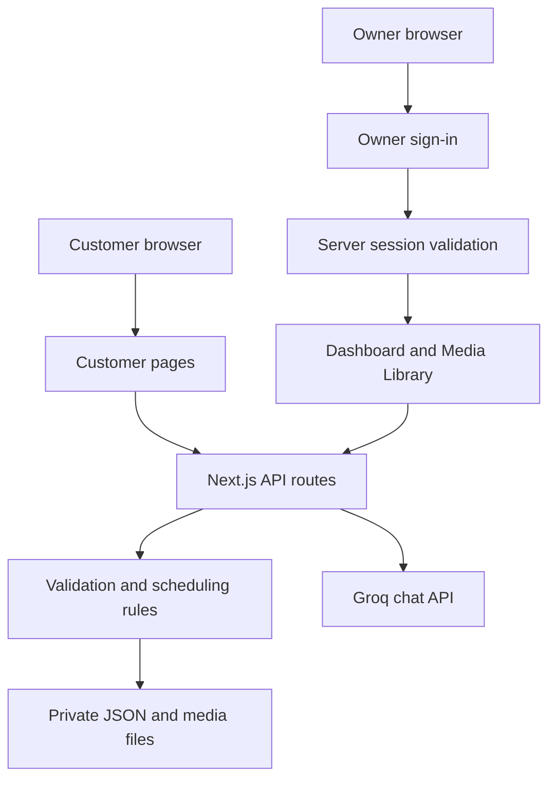
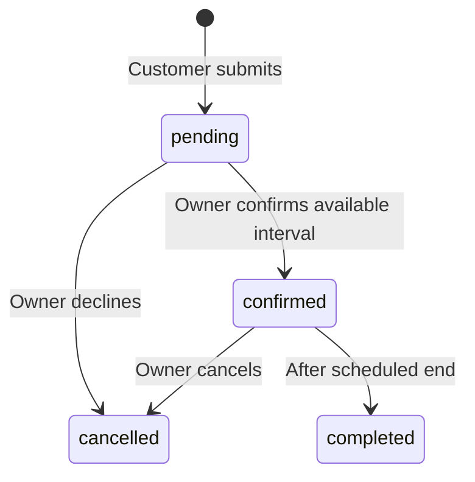

# Hair Masters — complete project workflow

This guide describes the implemented application. All paths are relative to the `hair-masters` project root. Run terminal commands there, not inside `src`.

## 1. Architecture

Next.js 15 App Router serves customer pages, protected owner pages and server APIs. React 19 provides the interactive interface; Lucide supplies icons. Local deployments use JSON/media files on disk. Vercel deployments store JSON and media objects in a private Blob store. Groq is optional, with a local FAQ fallback.



Owner access is enforced on the server. Hiding an owner button alone does not protect records or management actions.

## 2. Detailed folder structure

```text
src/
├── app/
│   ├── layout.js                   HTML layout, metadata and viewport settings
│   ├── page.js                     Public entry point and URL parsing
│   ├── globals.css                 Shared styles, themes and responsive rules
│   ├── admin/
│   │   ├── layout.js              Owner metadata/layout
│   │   ├── page.js                Server-protected owner entry point
│   │   └── login/page.js          Sign-in page
│   └── api/
│       ├── admin/session/route.js  Session checks, login and logout
│       ├── appointments/route.js  Appointment creation/list/status changes
│       ├── appointments/[id]/route.js  Private customer receipt
│       ├── availability/route.js  Public schedule without customer details
│       ├── chat/route.js          Groq and FAQ fallback
│       ├── media/route.js         Media list/upload/management
│       └── media/[id]/route.js    Media bytes, privacy and byte ranges
├── components/
│   ├── layout/SalonApp.js         Shell and customer flow coordination
│   ├── auth/AdminLogin.js         Owner login form
│   ├── appointments/
│   │   ├── AppointmentDashboard.js
│   │   └── AppointmentConfirmation.js
│   ├── media/
│   │   ├── MediaLibrary.js        Owner manager and customer Lookbook
│   │   └── MediaViewer.js         Image/video viewer
│   └── brand/BrandPages.js        Brand, location, editorial and enquiry pages
├── hooks/
│   ├── useAppointments.js         Schedule polling, mutations and receipt updates
│   └── useChatViewport.js         Mobile chat visual-viewport handling
└── lib/
    ├── booking/
    │   ├── appointments.mjs      Time, duration, overlap and status rules
    │   └── receipt.mjs           Browser receipt-handle storage
    ├── chat/chat-viewport.mjs     Pure chat geometry calculations
    ├── data/
    │   ├── salon.mjs             Services, branch facts and FAQ responses
    │   └── reference.mjs         Brand directory, articles and media catalog
    ├── navigation/navigation.mjs Public navigation definitions
    ├── search/
    │   ├── search.mjs            Shared text matching
    │   └── service-search.mjs    Service terms and aliases
    └── server/
        ├── admin-auth.mjs        Passwords, sessions and origin checks
        ├── appointment-store.mjs Appointment persistence and write locks
        ├── media-store.mjs       Media validation, metadata and files
        └── json-store.mjs        Shared JSON persistence helper
```

Other project-root folders:

| Folder/file | Responsibility |
| --- | --- |
| `public/images/` | Static site images |
| `public/images/original/` | Reference images, salon film and provenance in `SOURCES.json` |
| `tests/unit/` | Automated `*.test.mjs` tests |
| `scripts/` | Owner setup, live AI check and HTTP/auth verification |
| `docs/qa/` | Historical testing reports |
| `.data/` | Private runtime records and uploads; ignored by Git |
| `.env` | Private environment configuration; ignored by Git |
| `.env.example` | Template without secret values |
| `package.json` / `package-lock.json` | Commands, dependencies and locked versions |
| `next.config.mjs` | Framework and build-directory settings |
| `.next` / `.next-dev` | Generated production/development output |
| `node_modules` | Installed dependencies |

Keep `src/lib/server` exclusively in server code. Browser components may use pure rules and public data from other `lib` folders, but must not import filesystem stores or authentication internals. Keep route handlers focused on parsing, access checks and responses; put scheduling rules in `lib/booking`.

`SalonApp.js` still coordinates several customer sections. New substantial features should get dedicated components rather than accumulating unrelated code in the shell.

## 3. Local setup

1. Install Node.js 20.9+ and open the project root in your editor.
2. Run `npm ci` to install the locked dependencies.
3. On a fresh checkout, copy `.env.example` to `.env`. Preserve an existing `.env`.
4. Configure Groq if needed, then run `npm run admin:setup` once.
5. Run `npm run dev` and visit http://localhost:3000.
6. Visit `/admin/login` for owner access.

Owner setup never overwrites an existing account. For a new account, credentials are delivered in `.data/admin-login.json`; the account store contains a salted scrypt password hash. Save generated credentials in a private password manager. The delivery file is sensitive plaintext even though Git ignores it.

Restart after environment changes. Development uses `.next-dev`; production uses `.next`. Do not edit generated output or installed dependencies.

## 4. Environment configuration

| Variable | Purpose | Default/notes |
| --- | --- | --- |
| `GROQ_API_KEY` | Server-only Groq credential | Optional; absent key uses FAQ responses |
| `GROQ_MODEL` | Groq model identifier | `openai/gpt-oss-20b` |
| `APP_ORIGIN` | Expected origin for protected mutations | Set exact public HTTPS origin, without a path |
| `ADMIN_SETUP_EMAIL` | Initial owner email | `owner@hairmasters.local`; setup only |
| `ADMIN_SETUP_PASSWORD` | Initial owner password | Random if omitted; supplied password must be 16–256 characters |
| `ADMIN_DATA_FILE` | Owner account/session store override | `.data/admin-auth.json` |
| `APPOINTMENTS_DATA_FILE` | Appointment store override | `.data/appointments.json` |
| `MEDIA_DATA_DIR` | Upload directory override | `.data/media` |
| `NEXT_DIST_DIR` | Alternate build-output directory | `.next-dev` for development; `.next` for production |

Use absolute paths for persistent-store overrides. Never put secret values into `public`, browser code, screenshots or Git. `OPENAI_API_KEY` does not configure the current Groq integration.

## 5. Customer workflow

### Discovery and navigation

The homepage exposes search, categories and booking near the beginning. Customers can search services, browse categories, inspect estimates/durations, save favourites and book directly from a service card. Typed service search clears a stale category; location search clears a stale region filter.

Marketing pages use `/`, `/about`, `/locations`, `/women`, `/men`, `/franchise`, `/news`, `/blogs` and `/contact`. The booking workspace uses `/salon` with `section=home`, `services`, `gallery`, `booking` or `saved`. Old `/?section=...` links redirect to their new address, preserving service searches/categories. Server entry points handle direct links and refresh.

### Appointment request

1. Select one or more services. Booking from a service card preselects it and opens date/time selection.
2. Choose a date and available start time. Total duration includes every selected service.
3. Enter a name/phone number, acknowledge staff confirmation and submit.
4. The server validates the current schedule and saves a `pending` request.
5. A receipt appears. The owner reviews the request and confirms it if available.
6. The customer receipt updates through polling.

No customer account or payment is required. The schedule has **one reservation lane**, not separate employee calendars. Pending requests do not reserve time. Confirmed and completed records exclude overlapping intervals. Starts are hourly from 10 AM through 6 PM, and services must finish by 9 PM. Time validation uses `Asia/Kolkata`.

At creation, the API issues a private receipt token and stores its hash. The browser keeps only the receipt ID/token in session storage so the same tab can recover the receipt after refresh. Names and phone numbers are fetched through the protected endpoint, not stored in that receipt object. Starting another appointment clears the previous handle. This is not permanent cross-device booking history or a customer account.

### Lookbook and enquiries

The Lookbook combines reference media with owner-published uploads. Customers can navigate full-size images and play videos. Upload management is owner-only.

Contact and franchise forms prepare WhatsApp enquiries for visitors to send. The app does not send messages, SMS or email automatically. Blog previews link to original full articles; news cards link to publishers. Maps links open Google Maps and phone links hand off to the device's calling application.

## 6. Owner workflow and security

1. Sign in at `/admin/login` using the configured account.
2. The server verifies the password hash and creates an opaque session cookie.
3. `/admin` validates the session before rendering owner content.
4. Review pending requests, dashboard totals and upcoming confirmed visits. Filter by status/date or search customer/service/phone.
5. Confirm a request to reserve the full service duration. The server checks conflicts again inside its write transaction.
6. Decline a pending request or cancel a confirmed visit when needed. The UI asks for confirmation and retains the cancelled record in history. Cancellation frees reserved time.
7. Mark a confirmed visit completed only after its scheduled end time.
8. Sign out to invalidate the session and clear its cookie.



Completed/cancelled records are terminal in the current workflow. There is no public owner registration, password-reset screen, multi-owner permission system or staff calendar.

Local file-backed sessions expire after eight hours. Environment-backed hosting sessions expire after one hour. Cookies are HttpOnly and SameSite=Strict; HTTPS adds Secure and the `__Host-` prefix. Outside localhost, owner sign-in requires HTTPS. Five failed logins trigger a 15-minute cooldown in the account store. The failure counter is shared for this single account rather than per IP.

Visible schedule tabs refresh approximately every five seconds and on focus. This is polling, not WebSocket push. Protected mutations validate the request origin. Public availability omits names, phone numbers and booking IDs. Customers access their own receipt with its bearer token.

## 7. Owner media workflow

1. Sign in and open **Media Library**.
2. Choose JPG/PNG/WebP up to 8 MB or MP4/WebM up to 30 MB.
3. Enter a caption/category and upload. Persistent success/error feedback reports the result.
4. New uploads start as private drafts.
5. Open the item's editor, select Published visibility and save to show it to customers.
6. Edit details, reorder items or return them to draft as needed.
7. Delete deliberately: deletion is permanent within the application.

Metadata is `.data/media/library.json`; media bytes use generated filenames in the same directory. Back them up together. Draft bytes require owner authentication; published bytes are public. The server validates file types and supports video byte ranges.

## 8. API reference

| Route | Method | Access/behavior |
| --- | --- | --- |
| `/api/admin/session` | GET | Session/configuration status |
| `/api/admin/session` | POST / DELETE | Login / logout with origin validation |
| `/api/appointments` | POST | Public creation with validation and origin check |
| `/api/appointments` | GET / PATCH | Owner-only full list / status change |
| `/api/appointments/[id]` | GET | Customer receipt with its bearer token |
| `/api/availability` | GET | Public scheduling fields only |
| `/api/media` | GET | Published items; `?admin=1` requires owner and includes drafts |
| `/api/media` | POST | Owner multipart upload with origin validation |
| `/api/media` | PATCH | Owner update, move or delete action |
| `/api/media/[id]` | GET | Published bytes or authenticated draft bytes; range support |
| `/api/chat` | GET / POST | Assistant mode / question response |

Keep server authorization intact when changing any UI. Invalid input, unauthorized access, disallowed origin, conflicting times and server failures have distinct error responses.

## 9. Chat workflow

The browser sends the question to `/api/chat`. The server validates it, attaches salon facts/instructions and calls Groq's OpenAI-compatible chat-completions endpoint. The key remains server-side. The request includes a bounded history of up to 10 turns/8,000 characters. Only user/assistant roles are accepted; client system/tool roles are discarded. Short acknowledgements such as “OK”, “oky” and “thanks” receive a brief local reply without restarting the greeting.

The assistant explains services and booking; it cannot save a request or confirm availability. Missing/rejected credentials, provider limits and outages trigger local FAQ responses with an availability notice. `npm run check:ai` sends a real small request and consumes account quota. Automated chat tests mock provider responses.

## 10. Persistence and backups

| Location | Contents | Handling |
| --- | --- | --- |
| `.data/appointments.json` | Customer requests, statuses and token hashes | Private; back up |
| `.data/admin-auth.json` | Account hash, sessions and failure history | Private; back up securely |
| `.data/admin-login.json` | Initial credential delivery | Sensitive plaintext |
| `.data/media/` | Uploaded files plus metadata | Back up together |
| Browser local storage | Favourites, theme and legacy local state | Per browser |
| Browser session storage | Current receipt handle | Per tab/session |

Local stores use write locks and atomic replacement. They do not provide managed backups, replication or distributed database transactions.

For a consistent backup: stop application writes, securely copy the full `.data` folder and private deployment configuration, then resume. To restore: stop the app, restore matching JSON/media files, check permissions and restart. Protect backups as customer data. Do not erase `.data` to fix a login issue. Restoring only the media index without its files will produce broken media.

## 11. Maintenance map

| Change | Main location |
| --- | --- |
| Services, estimates, duration, branch facts and FAQ | `src/lib/data/salon.mjs` |
| Brand directory, editorial links and reference media | `src/lib/data/reference.mjs` |
| Search aliases/matching | `src/lib/search/` |
| Calendar hours, overlap/status rules | `src/lib/booking/appointments.mjs` |
| Customer shell and booking interface | `src/components/layout/SalonApp.js` |
| Owner appointment interface | `src/components/appointments/AppointmentDashboard.js` |
| Media manager and viewer | `src/components/media/` |
| Themes and responsive styling | `src/app/globals.css` |
| Public navigation definitions | `src/lib/navigation/navigation.mjs` |
| AI instructions/provider request | `src/app/api/chat/route.js` |
| Authentication/session rules | `src/lib/server/admin-auth.mjs` |

Routine photo/video additions use the owner library. Static files in `public` require a deployment change. Original media provenance is in `public/images/original/SOURCES.json`; confirm usage rights and salon content before publishing.

For a feature change, update the relevant component, business rules and server validation together. Add meaningful tests under `tests/unit` and keep this guide current. Never commit private data, generated builds or credentials.

## 12. Testing

```powershell
npm test
npm run build
# With a server running:
npm run check:http -- http://localhost:3000
npm run check:admin -- http://localhost:3000
```

The current suite reports 83 tests covering booking validation, persistence/concurrency, authentication, media privacy, search, receipt storage and mocked chat failure handling. The count will change with future coverage. Owner verification uses `.data/admin-login.json` and performs authentication/session actions; run it in development.

Manual acceptance: use customer and owner tabs; search/save a service, submit, confirm, check the updated receipt and blocked times, cancel and check restored availability. Test private/published uploads, image navigation, video playback, chat, error/empty states and direct URL refresh. Check both themes at 320, 390, 768 and 1440px. Test a physical phone keyboard separately.

`docs/qa` contains historical reports. Old paths, screenshots, deleted QA scripts and previous test counts in those reports are archival, not current setup instructions. Temporary screenshot/JSON evidence was removed during cleanup. Use isolated disposable stores for test mutations instead of real customer bookings.

## 13. Deployment

1. Provision one Node.js application instance with persistent writable storage.
2. Install with `npm ci` and configure private environment values.
3. Set `APP_ORIGIN` to the exact external HTTPS origin and configure the reverse proxy.
4. Provision persistent storage for appointments, authentication and media. Use absolute override paths if deployment directories change between releases.
5. Run owner setup only if an account is absent in persistent storage.
6. Run tests/build, then `npm start` under a process supervisor.
7. Verify customer pages, owner access, booking confirmation, uploads and chat through the public origin.
8. Arrange secure backups and monitor application/provider failures.

The app requires server-side APIs, not static HTML hosting. Local-file mode requires one server with a persistent disk. Vercel mode uses shared private Blob storage and conditional ETag updates across instances; do not use its ephemeral disk for records or uploads.

## 14. Troubleshooting

| Symptom | Check |
| --- | --- |
| Chat uses FAQ | Save Groq key, restart, run `check:ai`; verify provider limits/model access |
| Owner login fails | Correct credentials, account exists, cooldown elapsed; do not erase the store |
| Mutation returns 403 | Exact `APP_ORIGIN`, browser origin and HTTPS proxy configuration |
| Upload absent for customer | Successful upload, Published visibility, same persistent media folder |
| Slot still visible | Pending requests do not reserve; verify confirmed status/date/duration and same server |
| No available times | Past day/time, overlap, or combined duration exceeds closing time |
| Receipt absent on another device | Receipt is tied to a browser session, not an account |
| Deployment changes missing | Rebuild/restart; confirm correct deployed source/environment |
| Save fails | Writable disk, free space and correct store paths/permissions |
| Port 3000 occupied | Stop the intended existing app or use `npm run dev -- --port 3002` |

## 15. Current scope

One salon reservation lane and one owner account. No multi-tenant SaaS, staff resource assignment, payments, automatic notifications, recurring gym memberships or database. Responsive browser checks do not certify every physical device. Prices/durations are starting estimates that staff must verify. Preserve these practical limits when extending or presenting the product.

## 16. Owner login on Vercel

The local `.data/admin-auth.json` is deliberately excluded from Git. Vercel does not receive that account, and its functions cannot maintain the application's persistent local files. Running local setup therefore does not configure the deployed website.

For an existing local account:

1. Run `npm run admin:export` locally. It creates ignored `.data/vercel-auth.env` without printing secrets and refuses to overwrite an existing export.
2. In Vercel project Settings → Environment Variables, add `ADMIN_AUTH_ACCOUNT` and `ADMIN_SESSION_SECRET` from that private file. The account value is the email/salt/password hash; no plaintext password is exported.
3. Set `APP_ORIGIN` to the deployed HTTPS origin, for example `https://saloon-seven-henna.vercel.app`.
4. Scope the settings to the intended environment and redeploy the updated source. Environment changes do not modify an existing deployment.
5. Sign in using the same owner email/password as locally. Test refresh, logout and direct `/admin` access on mobile and desktop.

Vercel automatically selects environment-backed authentication. The presence of either owner environment variable also selects it on other hosts. Missing or malformed values fail closed instead of silently using a different account. Local installations without these settings retain the existing file-backed account and sessions.

Environment mode uses signed, HttpOnly, SameSite=Strict cookies, Secure on HTTPS, with a one-hour lifetime. Changing the account hash or signing secret invalidates old signatures. Logout clears the browser cookie and revokes it in the current warm instance. **Revocation and the login throttle are memory-local, not shared across serverless instances**: a copied cookie can remain valid elsewhere until expiry. Use platform-wide login rate limiting; use shared session storage if immediate global revocation is required. The local file-backed mode retains shared-on-disk revocation and throttling.

Owner authentication and data storage are separate. After setting up authentication, connect the Private Blob store described below. The application now supports that durable storage backend without a database. Do not use `/tmp` for persistent records or uploads.

References: [Vercel runtime filesystem](https://vercel.com/docs/functions/runtimes), [environment variable deployment behavior](https://vercel.com/docs/environment-variables).

### Deployment configuration diagnostics

The owner login page and `/api/admin/session` report a safe configuration issue when setup fails: `account_missing`, `account_format`, `account_fields`, `secret_missing` or `secret_format`. They never return the configured value, email, hash or signing secret. Missing values usually require checking the project/environment scope and redeploying; malformed values require copying the complete value from the private export. Surrounding whitespace, ordinary quotes and copied `NAME=` prefixes are normalized before validation. Invalid or incomplete account/hash values still fail closed.

## 17. Production bookings and media on Vercel — no database

Create/connect a **Private** Vercel Blob store to the project and its Production environment. Vercel normally adds `BLOB_READ_WRITE_TOKEN`. Keep this token server-only; never use a `NEXT_PUBLIC_` name. Redeploy after the connection. Blob usage is subject to the limits/billing of the connected account; do not assume unlimited free storage.

Storage selection is automatic: Vercel or a configured Blob token selects cloud mode; local development without that token keeps the existing filesystem behavior. Missing cloud credentials fail with an availability error and never fall back to temporary/empty local data. Optional local file-path overrides apply to local-file mode.

Cloud objects are private:

- `hair-masters/data/appointments.json`: requests, owner status and receipt token hashes.
- `hair-masters/data/media.json`: ordered media metadata and draft/publication state.
- `hair-masters/uploads/<uuid>.<extension>`: uploaded bytes.

The cloud JSON adapter reads origin storage with `useCache: false`. Updates use ETag `ifMatch` and retry conflicts. Initial creation forbids overwrites, so concurrent first writes also retry safely. Confirmations revalidate the entire treatment interval against the latest committed schedule. This prevents lost updates and overlapping confirmations across instances. JSON object storage suits this app's small schedule; large traffic/data volumes need an appropriately scalable data model.

Uploads use authenticated, same-origin, short-lived tokens for one generated pathname. The browser sends bytes directly to Blob, bypassing Vercel Functions' ordinary upload-body limit. The owner then finalizes the media through a small JSON request. The server checks size, type signatures, caption and category before registering a private draft. Completed registration is idempotent for that pathname. Photos remain limited to 8 MB and videos to 30 MB. Upload progress and finalization feedback appear in the owner form.

Customer media requests still go through `/api/media/[id]`; unpublished bytes require an owner session. Published streams and video ranges are proxied without exposing the storage token. A failed/abandoned direct upload may leave an unregistered private object; it never appears in the public Lookbook. Review orphaned objects in the storage dashboard when maintaining storage. Existing local `.data` records/uploads are not automatically copied into production.

New code: `src/lib/server/cloud-storage.mjs`, `cloud-media-store.mjs`, `media-validation.mjs`; new routes: POST `/api/media/upload` (owner-only upload token), POST `/api/media/complete` (owner-only validated registration). GET `/api/media?admin=1` includes the upload mode for the owner UI.

References: [Vercel Blob](https://vercel.com/docs/vercel-blob), [client uploads](https://vercel.com/docs/vercel-blob/client-upload), [conditional writes and consistent reads](https://vercel.com/docs/vercel-blob/using-blob-sdk).

### Conditional-write ETags and compression

Cloud JSON snapshots request `Accept-Encoding: identity`. A compressed HTTP representation can return a weak `W/` transport ETag which cannot be used for an atomic `If-Match` update. Uncompressed origin reads retain the strong ETag and keep conflict protection working as the schedule/media index grows. Owner-only GET `/api/admin/storage` exposes safe presence/weakness/matching flags for diagnostics; it never returns booking data, store tokens or actual ETag values.

## 18. Separate landing website and booking workspace

The public brand website is now the main homepage. Its minimal header/footer link to all eight informational pages, and its booking links open the existing application on the same domain. Customer data, owner access, storage objects and API endpoints keep their existing locations.

| URL | Purpose |
| --- | --- |
| `/` | Minimal marketing homepage |
| `/about`, `/locations` | Brand story and searchable branch directory |
| `/women`, `/men` | Service information and booking links |
| `/franchise`, `/news`, `/blogs`, `/contact` | Partnerships, editorial content and enquiries |
| `/salon` | Existing customer application home |
| `/salon?section=services` | Searchable service catalog and prices |
| `/salon?section=booking` | Existing three-step appointment request |
| `/salon?section=gallery` | Customer Lookbook |
| `/salon?section=saved` | Browser favourites |
| `/admin`, `/admin/login` | Protected owner workspace and login |

`src/components/landing/LandingSite.js` owns the marketing shell/homepage and `landing.css` owns its scoped styles. `src/components/brand/BrandPages.js` supplies the existing eight informational pages inside that shell. Their booking actions are real links, so they also work before hydration and support opening in a new tab. `src/app/[section]/page.js` explicitly permits only the eight brand routes and rejects unknown destinations.

`src/app/salon/page.js` renders the existing booking app. Its old Explore/More brand menus are replaced by simple return links to the website. Marketing pages do not mount appointment polling or the full booking interface. Both experiences share theme/favourite storage on the same origin. Bookings still require owner confirmation and all storage/authentication checks remain server-side.

Legacy root query links redirect server-side; service queries/categories are retained. Legacy hash links are routed from the marketing shell to their new destination. Informational links under `/salon?section=...` and authenticated `/admin?section=...` lead to the corresponding brand page. Normal salon navigation remains within `/salon`; refresh and browser history retain the chosen section.

## 19. Services-first entry and regional location directory

Marketing-page Book now/Book an appointment links use `bookingEntryHref` and open Discover at `/salon?section=home`. Explicit Services links continue to open the service catalog. A service card’s Book this service action then opens date/time with that treatment preselected. `bookingHref` and old explicit `?section=booking` links still refer to the booking form so existing saved links remain compatible.

`src/components/brand/LocationsPage.js` and `locations.css` own the redesigned directory. `src/lib/data/locations.mjs` groups the existing public branch catalog without dropping or duplicating records. Desktop uses a city/region sidebar; mobile uses a native selector. All locations are grouped into expandable regional sections, with upcoming locations kept separate. Noida is expanded initially. Choosing a region shows only its branches; typing a search clears the region filter. Exact region-name searches avoid partial-name matches such as Punjab versus Punjabi Bagh. Address/area searches work across regions.

The directory retains directions, telephone and branch-detail links. Only Sector 104 uses this app’s services/booking flow; other branches keep their own contact/details destinations. Region names are display-normalized without changing the source identifiers.
